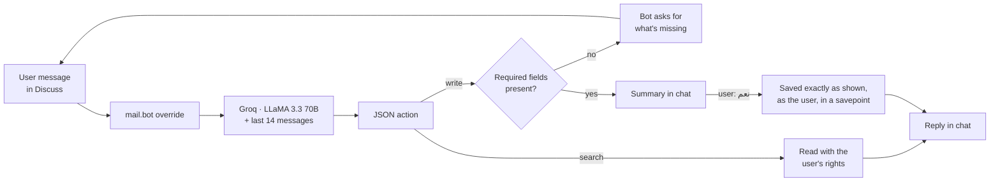

<p align="center">
  
</p>

# OdooBot AI

An Odoo 16 module that swaps the default OdooBot in Discuss for an LLM (LLaMA 3.3 70B on Groq).
You message it the way you'd message a coworker, and it creates or updates records for you:
authors, books, quotations, purchase orders and customers.

<div align="center">


</div>

<!-- TODO: add a short demo gif (docs/demo.gif) -->

## Why I built it

The built-in OdooBot is basically a scripted FAQ. It can't understand a normal sentence and it
can't do anything inside the system. I wanted to see how far you get if a model reads the
conversation, works out what the user wants, and hands a structured action to the Odoo ORM,
with a confirmation step so nothing gets written by accident.

## How it works



The parts that took the most work:

- The last 14 messages go to the model as context, so a follow-up like "غير تليفونه" works without repeating the name.
- The model has to answer in JSON. The module parses it, checks the required fields and asks for anything missing instead of creating half-empty records.
- The model never writes anything. Every create or update is shown as a summary first (with totals for quotations). When the user answers yes, the module reads the data back from that summary and saves exactly that, so what was confirmed is what gets saved.
- Everything runs as the user who wrote the message, with their own access rights. Someone who cannot create a quotation in the Sales app cannot create one by asking the bot.
- Name lookup is fuzzy (`difflib`, threshold 0.62), so "مروان" still finds "Marwan Ashraf".
- Quotation prices are pulled from the book or product record, so nobody has to type them.
- If Groq rate-limits the request, the common flows (like building a quotation) are handled locally so the chat doesn't just break.
- Arabic, English or a mix of both, typos included. Replies are formatted right-to-left.

## Example conversations

### Adding an author
```
Mitchell Admin:   ضيفلي مؤلف اسمه سامر سمير رقمه 055889
OdooBot:          تأكيد العملية 🔍
                  ➕ إضافة مؤلف جديد
                  👤 الاسم: سامر سمير
                  📞 التليفون: 055889
                  تأكد وأكمل؟ (نعم / لا)

Mitchell Admin:   نعم
OdooBot:          تمام! المؤلف اتضاف ✅
                  👤 سامر سمير
                  📞 055889
                  📧 —
```

### Creating a quotation with auto-pricing
```
Mitchell Admin:   عايز اعمل عرض سعر
OdooBot:          أي منتج؟

Mitchell Admin:   كتاب المبيعات
OdooBot:          كام كمية؟

Mitchell Admin:   3 كتب
OdooBot:          لسه محتاج: اسم العميل

Mitchell Admin:   العميل محمد سمير
OdooBot:          تأكيد العملية 🔍
                  ➕ إنشاء عرض سعر
                  👤 العميل: محمد سمير
                  📦 المنتج: كتاب المبيعات
                  🔢 الكمية: 3
                  💰 السعر: 520.00
                  🧮 الإجمالي: 1560.00
                  تأكد وأكمل؟ (نعم / لا)

Mitchell Admin:   نعم
OdooBot:          تمام! عرض السعر اتعمل ✅
                  🧾 S00023
                  👤 محمد سمير
                  📦 المبيعات
                  🔢 الكمية: 3
                  💰 سعر الوحدة: 520.00 جنيه
                  🧮 الإجمالي: 1778.40 LE
```

### Updating a record
```
Mitchell Admin:   change samer's phone to 01099999999
OdooBot:          تم التعديل ✅
                  👤 samer
                  📞 01099999999
                  📧 samer124@gmail.com
```

## What it can do

| Feature | Status |
|---------|--------|
| Add / update / search authors | ✅ |
| Add / update / search books | ✅ |
| Create quotations (auto-price from book) | ✅ |
| Create purchase orders | ✅ |
| Add / search customers | ✅ |
| Search products with stock & price | ✅ |
| Confirmation before every write, saved exactly as shown | ✅ |
| Runs with the user's own access rights | ✅ |
| Fuzzy Arabic/English name matching | ✅ |
| Full conversation memory (14 messages) | ✅ |
| Rate limit fallback (local handling) | ✅ |
| RTL formatted chat responses | ✅ |

## Tech details

| | |
|---|---|
| ERP | Odoo 16 Community |
| Model | LLaMA 3.3 70B |
| Inference | Groq Cloud |
| Hook | `mail.bot` inheritance |
| Context | last 14 messages |
| Name matching | `difflib.SequenceMatcher` (score ≥ 0.62) |
| Writes | Odoo ORM as the current user, inside a savepoint |
| Tests | 41 logic tests and 9 Odoo integration tests, run on every push |
| Config | Settings > AI Bot (Groq), or `GROQ_API_KEY` |

The module only inherits `mail.bot`. No core files are touched, so uninstalling it leaves nothing behind.

## Adding another module

Supporting a new model means adding three things. First the action in the system prompt:

```python
{"action": "create_employee", "name": "", "job_title": "", "department": ""}
```

Then the handler mapping:

```python
handlers = {
    ...
    'create_employee': self._exec_create_employee,
}
```

And the handler itself:

```python
def _exec_create_employee(self, data):
    employee = self.env['hr.employee'].create({
        'name': data.get('name'),
        'job_title': data.get('job_title') or '',
    })
    return f"✅ Employee added: {employee.name}"
```

The model picks the new action up from the prompt, there's nothing to retrain.

## Requirements

- Odoo 16 Community with `mail`, `sale_management` and `purchase`
- A Groq API key (the free tier is enough for testing and internal use)
- The author and book actions expect `library.author` and `library.book` from a library module, which is what I used for the demo. Quotations, purchase orders, customers and product search work on a standard Odoo install. Stock levels show in product search when the Inventory app is installed.

## Setup

1. Get a key from [console.groq.com](https://console.groq.com).
2. Clone the module into your addons path:
   ```bash
   git clone https://github.com/Marwankhater/AI_bot_for_odoo16.git ai_bot_for_odoo16
   ```
3. Restart Odoo, update the apps list, search for "OdooBot AI" and install it.
4. Go to Settings > General Settings > AI Bot (Groq) and paste the key. Setting `GROQ_API_KEY` in the server environment works too.
5. Open Discuss and message OdooBot.

Without a key the bot behaves like the normal OdooBot.

## Tests

```bash
# The text logic: summaries, yes and no, required fields, name matching. No Odoo needed.
cd tests_unit && pytest

# Inside Odoo 16, with the model replaced by a stub, so no key or network is needed.
odoo-bin -d test_db -i ai_bot_for_odoo16 --test-tags /ai_bot_for_odoo16 --stop-after-init
```

The Odoo tests check the things that matter most: nothing is created before a yes, a "no" cancels,
a model reply asking to execute still produces a summary, names are saved as typed, and users
without Sales or Contacts rights are refused. Both suites run on every push
(`.github/workflows/tests.yml`).

## Why Groq and LLaMA

Every reply can end up as a database write, so the model has to stick to the JSON format. LLaMA 3.3 70B
is reliable at that and handles Arabic well, and Groq is fast enough that the chat doesn't feel laggy.

## Roadmap

- Voice input
- Reports through chat
- Scheduled reminders
- HR, Inventory and Accounting actions

## License

LGPL-3, same as Odoo Community.

---

Made by [Marwan Khater](https://www.linkedin.com/in/marwan-khater-811660219/) · [GitHub](https://github.com/Marwankhater)
